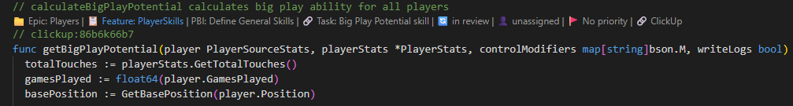
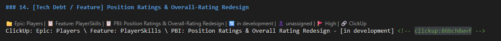
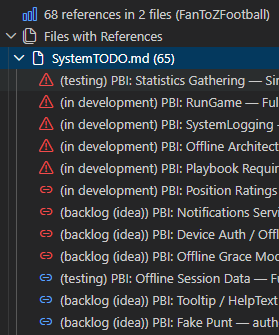
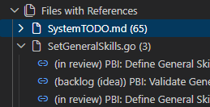

# ClickUpLink

What is ClickUpLink? A VS Code extension that provides seamless ClickUp task integration directly in your code editor with a dedicated sidebar panel and clickable breadcrumb navigation.

## 🚀 Features

- **Dedicated Sidebar Panel**: ClickUp icon in VS Code's activity bar with Authentication, Workspace, and References views
- **Simple Authentication**: Clear Step 1/Step 2 process with "Login" and "Enter Code" buttons in the sidebar
- **Workspace Overview**: See your connected workspace and quick actions in the sidebar
- **Insert Task References with a Hotkey**: `Alt+C+U` (hold Alt, press C then U)
- **Or Use Single-line comments**: Use `// clickup:[taskid]` (TypeScript, JavaScript, C#, Go), `# clickup:[taskid]` (Python), `-- clickup:[taskid]` (SQL), `' clickup:[taskid]` (VB.Net), or `<!-- clickup:[taskid] -->` (Markdown).
- **Or Use Block comments**: Insert `clickup:[taskid]` immediately after the opening of the block comment `/* clickup:[taskid] ... */`. Replace `[taskid]` with the actual ID of your ClickUp task. The extension will recognize this pattern and provide a link to the task.
- **Breadcrumb Navigation**: Visual breadcrumbs showing Folder → List → Task → Status with clickable links
- **Persistent References**: Task references survive VS Code reloads and are stored across sessions
- **References Management**: View and navigate to all task references organized by file in the sidebar
- **Real-time Updates**: Change task status, assignee, or task reference directly from VS Code

## 📦 Installation

Install **ClickUpLink** from the VS Code Marketplace: open the Extensions panel (`Ctrl+Shift+X`), search for "ClickUpLink" and click Install.

> ClickUpLink is an unofficial, community-built extension and is not affiliated with or endorsed by ClickUp. ClickUp is a trademark of its respective owner.

## 🎯 Getting Started

### 1. Open the ClickUpLink Sidebar
Click the ClickUpLink icon in VS Code's Activity Bar (left sidebar) to open the ClickUpLink panel.

### 2. Authenticate with ClickUp
1. **Click "Step 1: Login to ClickUp"** in the Authentication section
2. Your browser will open to ClickUp's OAuth page
3. Log into your ClickUp account and approve the permissions
4. **ClickUp will display an authorization code** - copy this code
5. **Click "Step 2: Enter Authorization Code"** in VS Code
6. **Paste the authorization code** when prompted
7. The Authentication section will show "✅ Connected to ClickUp"

### 3. Add Task References
- **Hotkey**: Place your cursor anywhere and press `Alt+C+U` (hold Alt, press C then U)
- **Sidebar**: Click "Add Task Reference" in the Workspace section
- Follow the prompts to select Folder → List → Task

### 4. Navigate with Breadcrumbs
After configuring a task reference, you'll see clickable breadcrumbs like:
```
📁 Development | 📋 Sprint 1 | 📝 Fix Login Bug | 🔄 In Progress | 🔗 Open in ClickUp
```

Each element is clickable to change folders, lists, tasks, or status.

In code, the breadcrumbs sit above the `// clickup:` comment:



In Markdown, use an HTML comment so the reference stays invisible in the rendered page:



### 5. Browse All References
The **Task References** view lists every reference in the workspace, grouped by file, with each task's status. Click one to jump to it.





## ⌨️ Keyboard Shortcuts

- `Alt+C+U` (hold Alt, press C then U) - Add task reference at cursor (Windows, Linux and Mac)

## Pizza Time

If you enjoy this app and feel it deserves a donation to my pizza fund and other development projects you can do so at:
https://ko-fi.com/activemindsgames

## Social Time

If you want to check out the game I am developing or any of the other dev work I am up to checkout my Youtube page:
[@ActiveMindGamesDev](https://www.youtube.com/@ActiveMindGamesDev)

## 🔧 Performance & Storage

ClickUpLink is designed for optimal performance with small to medium projects:

### Expected Performance
- **Excellent**: 1-100 task references
- **Good**: 100-500 task references  
- **Acceptable**: 500-1000+ task references

### Storage & Workspace Isolation
- Task references are stored locally in VS Code's global state
- References are automatically filtered by workspace/project folder
- Only references from your current project are displayed
- Switching between projects shows only relevant references

### Performance Optimization
If you notice decreased performance with large numbers of references (1000+), consider:
- Using "Clear Completed References" to remove finished tasks
- Regular cleanup of obsolete references
- The extension includes workspace-based filtering to improve performance automatically

### Reference Management
- Access cleanup tools via the Task References panel → Actions menu
- Use debug commands to monitor reference counts and performance
- References survive VS Code restarts and extension updates

## 🔒 Privacy & Security

- OAuth tokens stored securely in VS Code's secret storage
- Task references stored locally in VS Code's global state
- Only communicates with the ClickUp API for task information
- The OAuth login/token exchange is routed through the ClickUpLink auth service (clickuplink.netlify.app), which keeps the ClickUp client secret off your machine; it does not store your tasks or code

## 📄 License

This extension is licensed under the GNU General Public License v3.0 or later (GPL-3.0-or-later) - see the [LICENSE](LICENSE) file for details.

## 📝 Changelog

See [CHANGELOG.md](CHANGELOG.md) for a detailed history of changes and release notes.
